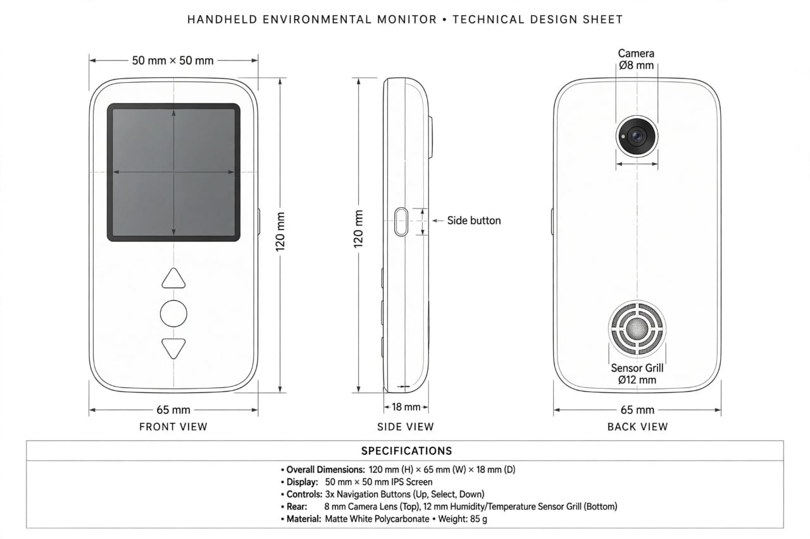

# ☕🌿 Cafecito MR · Monitor 3D, Herramientas de Campo & Meta Quest 3 Mixed Reality

**Juego interactivo 3D explorable en Merged Reality y Mixed Reality** construido alrededor del **Monitor Ambiental Portátil (`120 × 65 × 18 mm`)** del *Proyecto Cafecito* y un **kit de herramientas físicas 3D independientes**:
- **📱 El Monitor Ambiental únicamente detecta y diagnostica** (requiriendo estar congruentemente en el menú **`[1.ESCÁNER]`** para escanear matas y lotes).
- **🧴✂️ Las herramientas físicas curan**: **Atomizador / Spray de Medicina** (con 3 fórmulas biológicas que cambian el color del tanque) y **Tijeras de Podar Bypass de Acero** (además del **Sello Certificador** para lotes sanos).

🔗 **Jugar en vivo (GitHub Pages):** **[https://jack1179.github.io/Cafecito-3d/](https://jack1179.github.io/Cafecito-3d/)**

---

## 🥽 Controles Ergonómicos en Meta Quest 3 (`🥽 Quest 3 MR` y `🥽 Quest VR`)

Ábrelo directamente desde **Meta Quest Browser** sobre HTTPS:

- **📱 Mano Izquierda — Monitor Ambiental Cafecito (`120 × 65 × 18 mm` a escala real 1:1)**
  - **Botones `X` / `Y`**: Cambiar libremente entre los 4 menús de la pantalla IPS (`[1.ESCÁNER]` ↔ `[2.CLIMA]` ↔ `[3.UV·IR]` ↔ `[4.FICHA]`), sin quedarse atrapado nunca en submenús.
  - **Gatillo Izquierdo**: Escanear la mata o bandeja de café (**congruente: requiere estar en el menú `[1.ESCÁNER]`**).
  - **Grip Izquierdo**: Girar el monitor `180°` para inspeccionar el lente `Ø8 mm` y la rejilla `Ø12 mm`.
- **🧴✂️ Mano Derecha — Herramienta Física de Curación (`Spray` / `Tijeras de Podar` / `Sello`)**
  - **Botones `A` / `B`**: Alternar entre las herramientas físicas 3D con etiqueta flotante sobre tu mano:
    1. **🧴 Spray: Bio-Fungicida** (tanque azul) → cura **Roya del Cafeto**
    2. **🧴 Spray: Beauveria** (tanque rojo) → cura **Broca del Café**
    3. **🧴 Spray: Nutrición NPK** (tanque dorado) → cura **Mancha de Hierro**
    4. **✂️ Tijeras de Podar** (cuchillas curvas de acero animadas) → cura **Antracnosis / Ramas Húmedas**
    5. **🏷️ Sello: Certificar Café Sano** → certifica matas y pergamino saludable
  - **Gatillo Derecho**: Accionar el **Spray** o cortar ramas enfermas con las **Tijeras de Podar**.
  - **Grip Derecho**: Ventilar el follaje cercano.
- **🚶 Locomoción Limpia**:
  - **Stick Izquierdo**: Caminar suavemente en 360° por todos los senderos de la finca.
  - **Stick Derecho (solo horizontal)**: Giro cómodo de `30°` (*snap-turn*) sin alterar los menús por accidente.

---

## 📐 Réplica 3D Exacta del Dispositivo (CAD 1:1)



| Característica | Especificación Implementada en 3D |
| :--- | :--- |
| **Dimensiones Totales** | `120 mm (Alto) × 65 mm (Ancho) × 18 mm (Profundidad)` · Peso `85 g` |
| **Material** | Policarbonato Blanco Mate (*Matte White Polycarbonate*) con línea de unión perimetral |
| **Pantalla Frontal** | **IPS cuadrada `50 mm × 50 mm`** dedicada 100% a diagnóstico (`1.ESCÁNER`, `2.CLIMA`, `3.UV·IR`, `4.FICHA`) |
| **Controles Físicos** | **3× Botones frontales 3D** (`▲`, `●`, `▼`) + **Side Button** lateral |
| **Sensores Traseros** | **Cámara Superior `Ø8 mm`** (*Picture-in-Picture* real hacia la pantalla IPS) + **Rejilla Concéntrica Inferior `Ø12 mm`** de Humedad y Temperatura |

---

## 🎮 Controles en PC, Móvil y Cámara MR

- **Caminar por el mapa**: **`W / A / S / D`** (`Shift` para correr), **Joystick virtual** inferior izquierdo, o **clic en cualquier punto/mata del Radar**.
- **Mirar 360°**: **Arrastra con el mouse o dedo** en la escena, o usa **`Q / E`** (`← / →`).
- **Cinturón de Equipo (Teclas `1` a `4`)**:
  - **`1` · 📱 Monitor**: Equipa el Monitor Ambiental. Usa **`↑ / ↓`** (`▲ / ▼`) para cambiar de menú y **`Espacio`** para escanear (estando en `[1.ESCÁNER]`).
  - **`2` · 🧴 Spray Medicina**: Equipa el Atomizador 3D (pulsa **`2`** de nuevo o `🧪 Cambiar Medicina` para alternar entre Azul Anti-Roya, Rojo Anti-Broca y Dorado NPK) y pulsa **`Espacio` / `Enter`** para rociar.
  - **`3` · ✂️ Tijeras de Podar**: Equipa las Tijeras de Podar 3D y pulsa **`Espacio` / `Enter`** para podar ramas con Antracnosis.
  - **`4` · 🏷️ Sello Sano**: Equipa el Sello Certificador para validar café sano.
  - **`R`**: Orientarte y caminar hacia la mata pendiente más cercana · **`F`**: Voltear el monitor `180°`.

---

## 🛠️ Desarrollo Local

```bash
npm install
npm run dev
```

Compilación de producción para GitHub Pages:

```bash
npm run build
npm run preview
```
